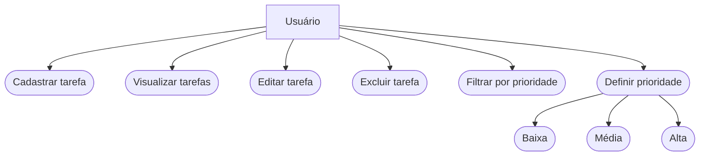
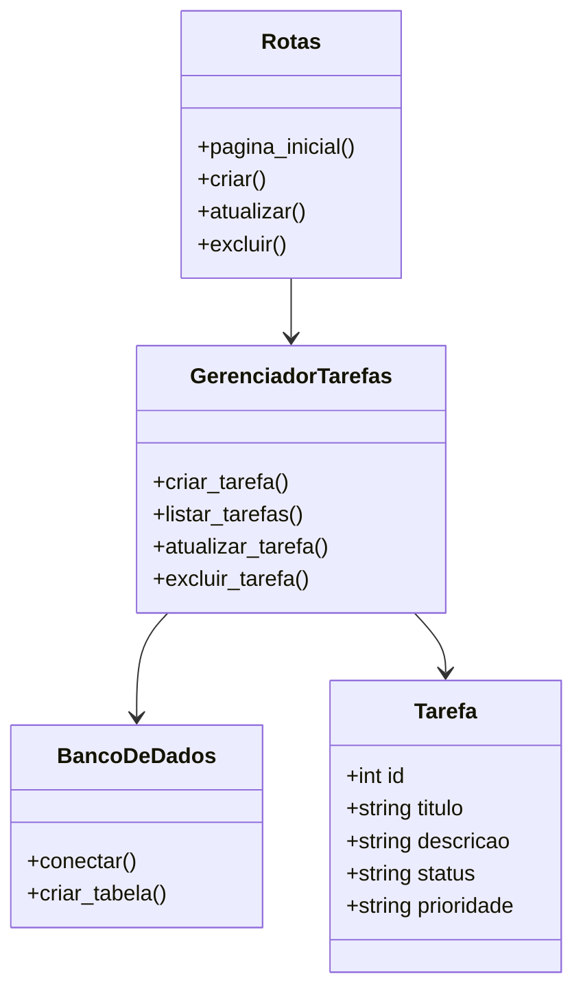

# Diagramas UML - TechFlow

## 1. Diagrama de casos de uso

O diagrama representa as funcionalidades disponíveis para o usuário no sistema.

## 2. Diagrama de classes

O diagrama representa a organização conceitual dos dados e componentes do TechFlow.

## Importância da modelagem

A modelagem UML ajuda a visualizar a estrutura e o funcionamento do sistema antes e durante o desenvolvimento.

No TechFlow, os diagramas permitem compreender as funcionalidades disponíveis ao usuário, os dados armazenados e a relação entre os componentes do projeto.
